# usa_election — 3D map of the 2026 U.S. midterm elections

An interactive **3D map of the United States** with a live **vote dashboard** for the
**2026-11-03 midterm elections**: **35 Senate races** (33 regular + special elections in
Ohio and Florida), **36 governor races** and all **435 House seats**. It is written in
C++20 and built with **Bazel (bzlmod only)**. 3D rendering uses **Vulkan**, and the 2D
dashboard is drawn with **Skia**. The UI is available in **English (default)**,
**Español**, **繁體中文** and **日本語**.

It is derived from [twn_election](https://github.com/merckhung/twn_election) (Taiwan's
2026 local elections) and keeps its engine: extruded map, drill-down, election-night
simulation with breaking news, secondary charts, picture-in-picture, LLM news
sentiment and the SQLite store.

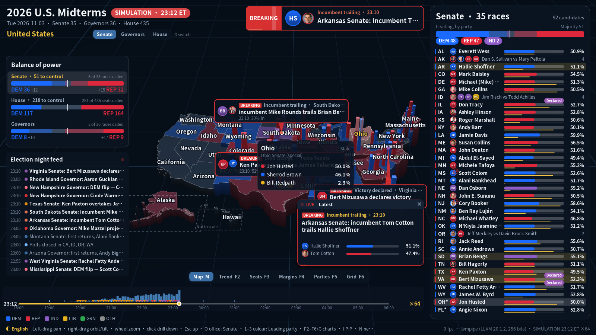

| | |
|---|---|
| 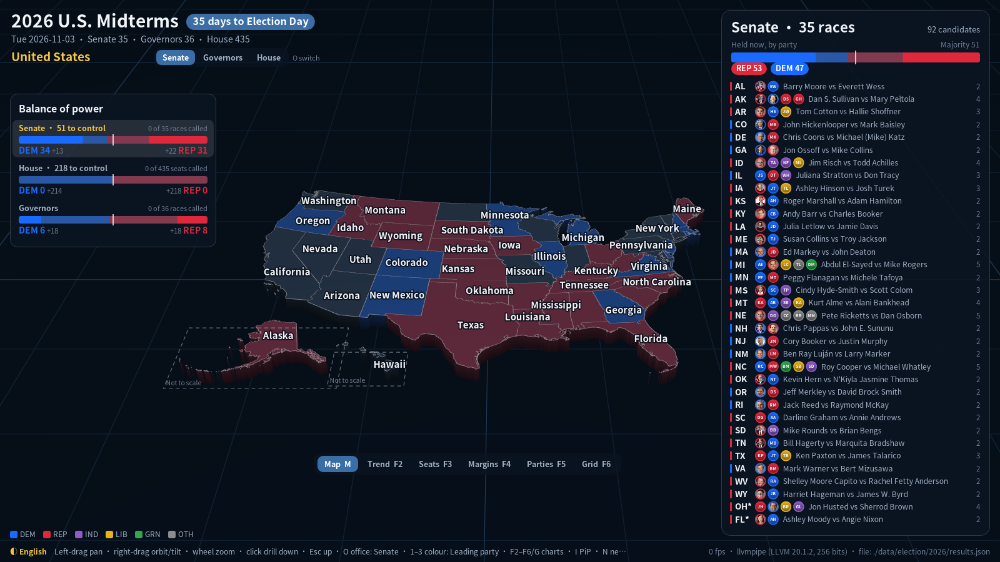 | 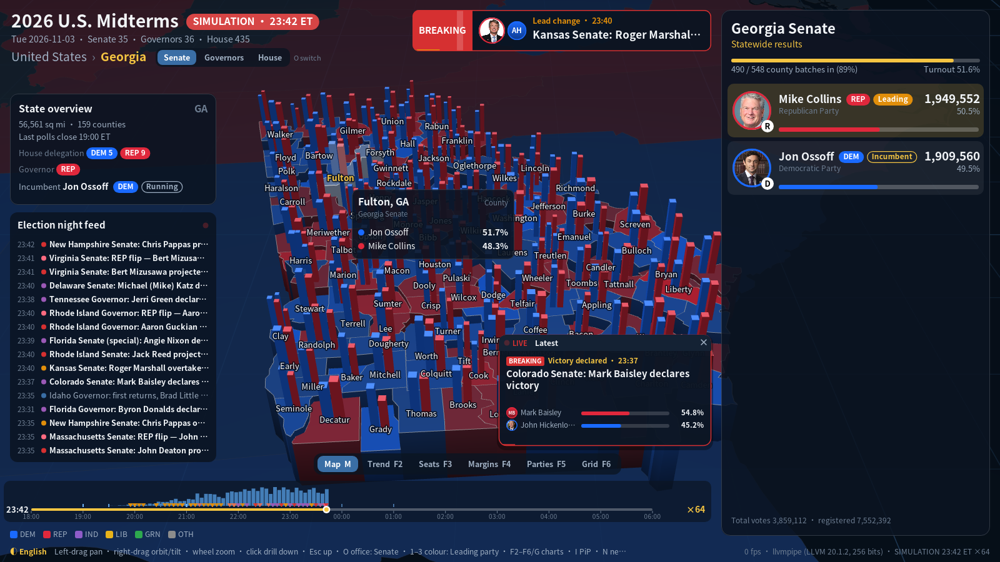 |
| 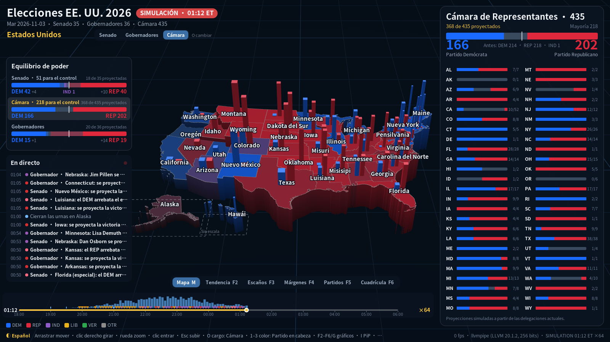 | 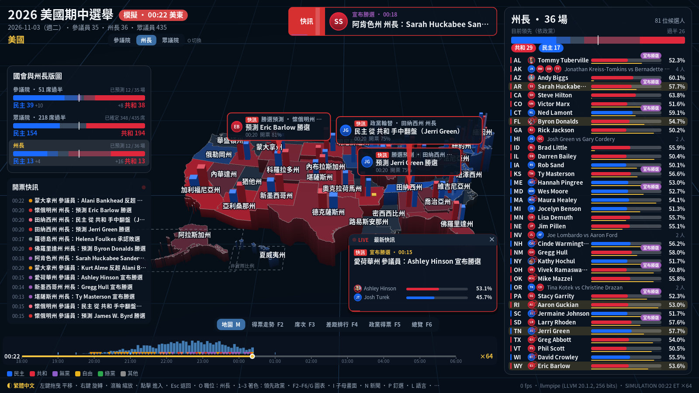 |
| 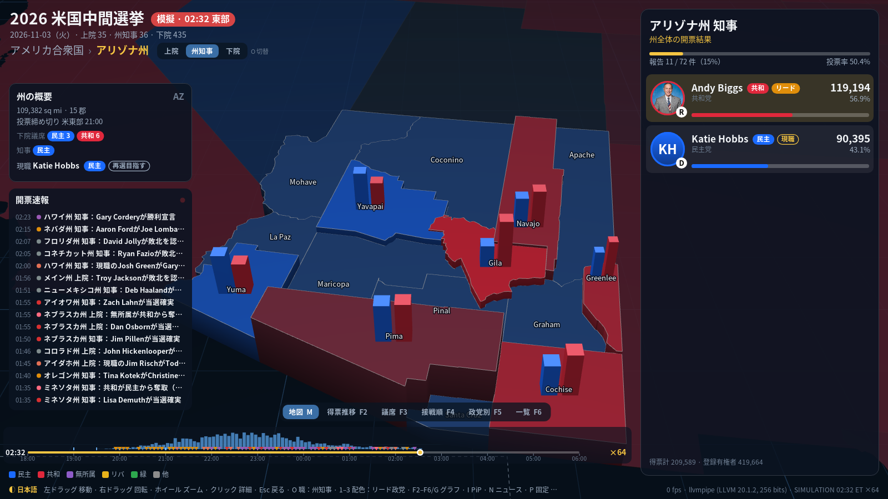 | 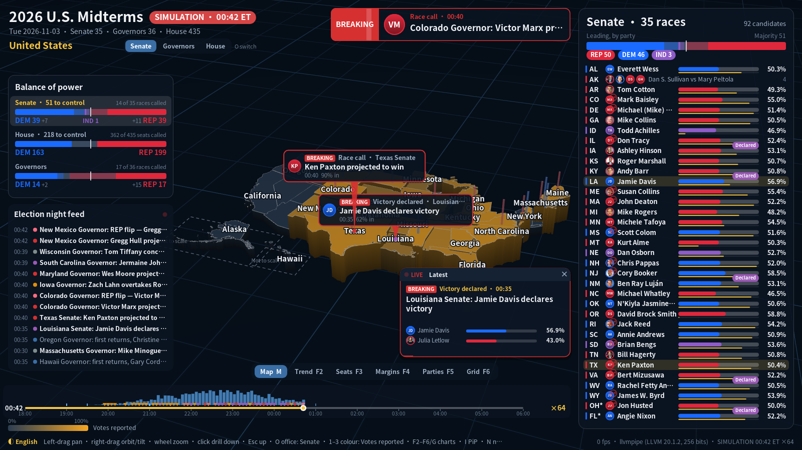 |

### Charts

| | |
|---|---|
| 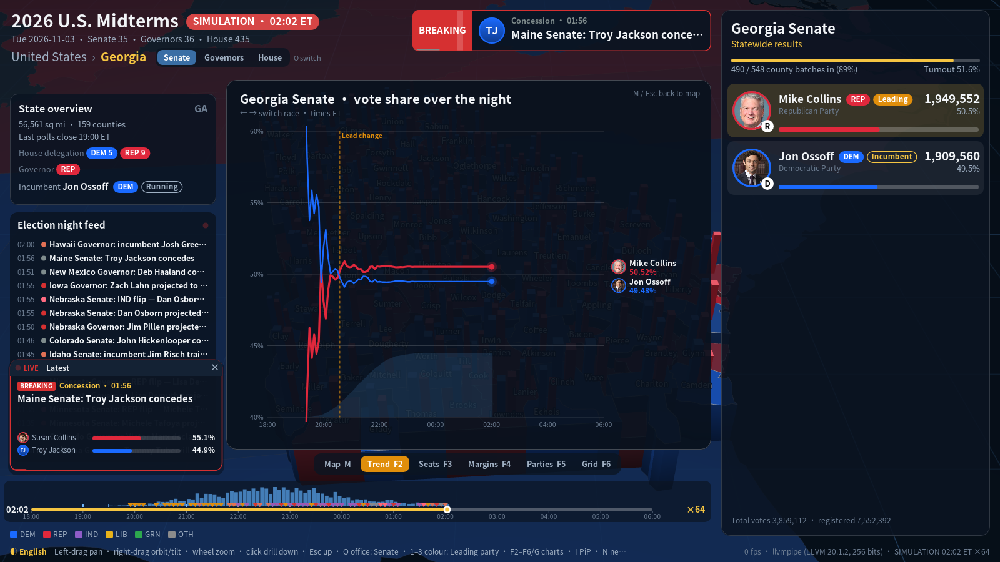 | 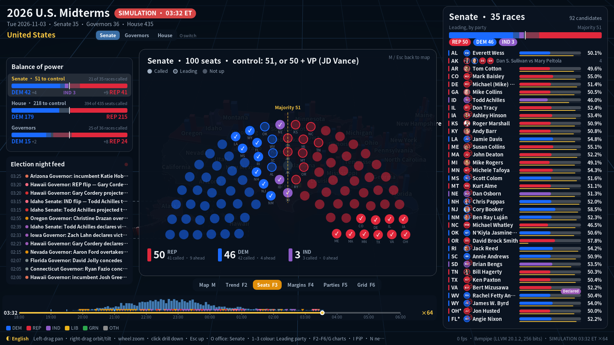 |
| 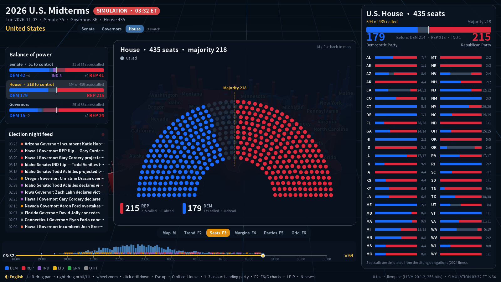 | 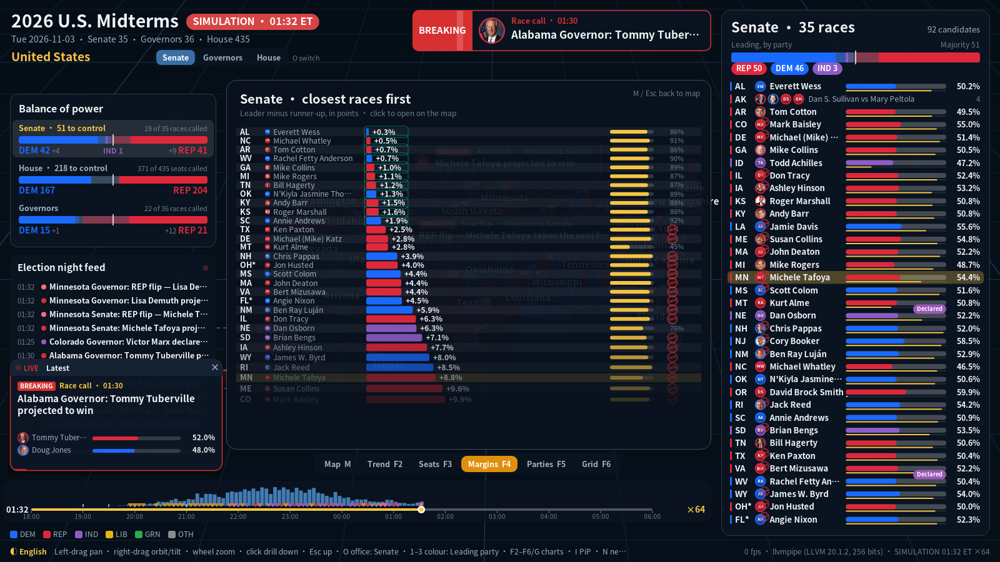 |
| 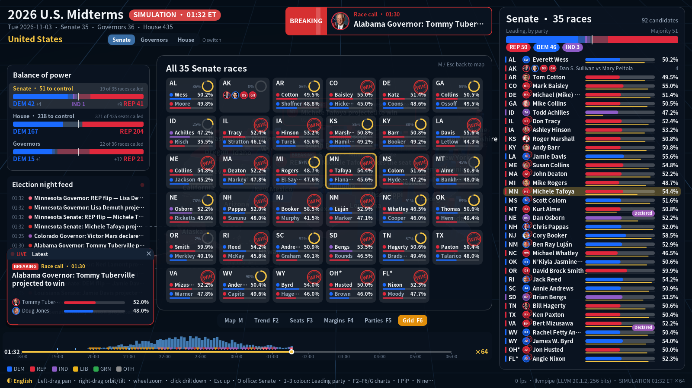 | 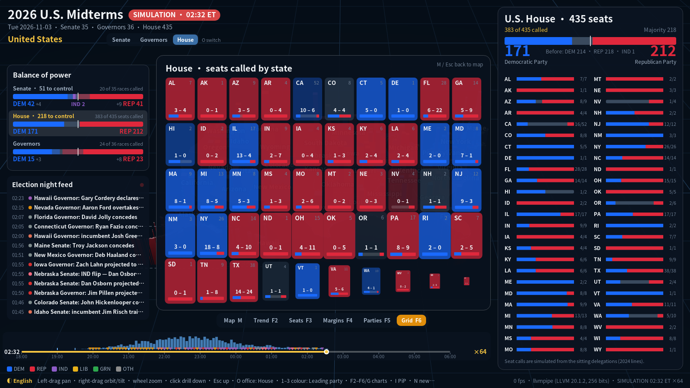 |

Demo clips (headless renders, 1280×720) are in [docs/demo/](docs/demo/); see
[docs/demo/README.md](docs/demo/README.md). Regenerate them with `tools/make_clips.sh`.

> All coloured "counting" images use the built-in **simulation** (`--simulate`). Its
> numbers are synthetic and random; which major party does better is a coin flip per
> race, and House seats start from the sitting delegations with random flips. They are
> **not** results, polls or forecasts, and the UI shows "SIMULATION" at all times.
> Before election day the app shows the real pre-election state: countdown, incumbents
> and the nominees.

## Features

- **3D U.S. map.** Every state and county (3,100+) is an extruded, lit prism rendered with
  Vulkan (4× MSAA, fog, grid). Alaska and Hawaii are insets (Albers USA, not to scale).
- **Navigation.** Grab-to-pan, zoom-to-cursor, orbit and tilt, animated fly-to. Click to
  drill down **United States → state → county**; Esc, Backspace or right-click goes back.
- **Three offices, one key.** `O` (or the Senate · Governors · House tabs, or a click on a
  balance-of-power bar) switches what the map, the panels and the charts show.
  - **Senate / Governors:** states and counties coloured by the leading candidate's party
    (by the incumbent's party before counting), vote bars on the map, candidate cards.
  - **House:** states coloured by seats called; per-state seat bars; a 435-seat panel.
- **Dashboard (Skia).**
  - Status chip: countdown to Election Day, polls open, counting (with ET clock).
  - **Balance of power:** Senate (holdovers + tonight, 51 for control or 50 + VP),
    House (218) and governors (50), with called seats solid and leading seats faded.
  - Race list for the office (35 or 36 rows) with portraits, leader, share, progress,
    "Declared" chips and **WIN** stamps.
  - State overview: area, counties, last poll closing (ET), House delegation, governor.
  - Race panel: candidate cards (portrait or initials, party, incumbent, share, rolling
    vote counts), declared/conceded status.
  - Tooltips on hover, pinned home region, help overlay (`H`).
- **Election night.** Per-state poll closings from 19:00 to 01:00 ET, county batches,
  race calls, seat flips, concessions, chamber control; see below.
- **Secondary charts** (`F2`–`F6`): trend, hemicycle (Senate 100 / House 435 / Governors
  50), margins, party votes, race grid, and a **picture-in-picture** "Latest" window.
- **News sentiment.** RSS/Atom/JSONL ingestion, OpenAI-compatible LLM classification
  (good/bad/neutral per candidate) with an offline heuristic fallback; labelled mock news.
- **SQLite** store for settings, results history, events and news.
- **Languages:** English (default), Español, 繁體中文, 日本語 — `L` cycles, `--lang=` selects.
  State and party names are localised; candidate and county names stay as published.

## Data

| File | Contents |
|---|---|
| `data/election/2026/candidates.json` | 71 races (35 Senate, 36 governor), 173 general-election nominees as of **2026-09-29**: party, incumbent, notes, bioguide IDs |
| `data/election/2026/election.json` | Chamber rules and composition: Senate 53 R · 45 D · 2 I before; holdovers 31 R · 32 D · 2 I; VP JD Vance breaks ties; House 218 R · 214 D · 1 I · 2 vacant; governors 26 R · 24 D; sources and unverified items |
| `data/election/2026/states.json` | 50 states + DC: FIPS, postal code, names (en/es/zh-TW/ja), last poll closing (ET), House seats and delegation, governor's party |
| `data/election/2026/parties.json` | Democratic, Republican, Independent, Libertarian, Green, other: colours and names in four languages |
| `data/map/counties-albers-10m.json` | us-atlas 3.0.1 (Census cartographic boundaries, pre-projected Albers USA) |
| `assets/photos/` | 45 official congressional portraits (public domain), `CREDITS.json`; everyone else gets an initials avatar |

Notable facts captured as of 2026-09-29 (from public reporting; items the research could
only confirm from a single source are listed in `election.json` → `unverified`):
- Senate specials: **Ohio** (Husted R vs. Sherrod Brown D) and **Florida** (Moody R vs.
  Angie Nixon D). Oklahoma's and South Carolina's seats have appointed Republican
  senators (Armstrong, Darline Graham); Graham is on the ballot, Armstrong is not.
- Nebraska, Idaho and South Dakota have independents as the main challengers (no Democrat).
- Alaska uses a top-four, ranked-choice general election; California a top-two.
- House delegations are the sitting members under the **2024 lines**; several states
  redrew their maps for 2026 (TX, CA, MO, NC, OH, UT, FL, LA, TN, AL — summarised in
  `election.json`). The House simulation therefore starts from today's delegations.

Offices not modelled: state legislatures, ballot measures, territorial delegates.

## Build & run

Prerequisites (Ubuntu/Debian):

```sh
sudo apt install build-essential libvulkan1 mesa-vulkan-drivers libglfw3-dev \
                 libcurl4-openssl-dev glslang-tools fonts-noto-cjk git
# Bazel: install bazelisk; .bazelversion pins Bazel 8.3.1
```

```sh
bazel run //:usa_election                          # window, English, Senate
bazel run //:usa_election -- --lang=es             # Español (also zh-TW, ja)
bazel run //:usa_election -- --office=house        # start on the House (or governor)
bazel run //:usa_election -- --simulate            # election night 18:00-06:00 ET (synthetic!)
bazel run //:usa_election -- --simulate --sim_speed=256 --sim_clock=21:30
bazel run //:usa_election -- --simulate --news     # + mock news, LLM/heuristic sentiment
bazel run //:usa_election -- --focus=GA            # start in Georgia (or FIPS 13, county 13121)
bazel run //:usa_election -- --results=/path/live.json   # watch a live feed file

# Headless (no display/GPU; works with lavapipe):
bazel run //:usa_election -- --headless --screenshot=$PWD/out.png --simulate --sim_clock=23:00
bazel test //tests/...
```

The first build fetches Skia (pinned commit) and compiles about 600 Skia sources, which
takes a few minutes. `--help` lists all flags.

### Controls

| Input | Action |
|---|---|
| Left-drag | Pan (the grabbed point stays under the cursor) |
| Right/middle-drag | Orbit / tilt |
| Wheel, `+`/`-` | Zoom to cursor |
| Click | Drill down (state → county); clicking a neighbour jumps to it |
| Esc / Backspace / right-click | Up one level |
| Arrows/WASD, Q/E, R/F | Pan, rotate, tilt |
| `O` | Office: Senate → Governors → House |
| `1` `2` `3` | Colour by leading party / votes reported (House: seats called) / turnout |
| `L` | Language: English → Español → 繁體中文 → 日本語 |
| `Space` | Pause / resume the simulation |
| `,` `.` | Simulation speed ×½ / ×2 (×1 real time … ×4096) |
| `[` `]` | Rewind / skip 30 simulated minutes |
| `F2`–`F6` | Charts: trend · hemicycle · margins · party votes · race grid (same key toggles back) |
| `G` / `M` | Cycle through the views / back to the map |
| `I` | Picture-in-picture "Latest" window |
| `←` `→` | (trend chart) previous / next race |
| `N` | News sentiment panel |
| `P` | Pin the current region as the start ("home") region; `P` again unpins |
| `Home` | Go to the pinned region (or the nation) · `H` help overlay |

## Election night

`--simulate` plays the night from **18:00 to 06:00 ET** (EST; daylight saving time ends
on Nov 1):
- Each state starts reporting when its **last polls close** (`states.json`): 19:00 ET
  (GA, IN, KY, SC, VA, VT) … 20:00 (the big wave) … 23:00 (CA, WA, OR, ID) … 01:00 ET
  (Alaska). A "Polls close" event lists the states of each wave, and small blue ticks on
  the timeline mark them.
- Every county reports in 1–12 batches (bigger counties, more batches) along a skewed
  curve over 5–8 hours. Mail-heavy states (CA, WA, OR, NV, AZ, UT, AK) count for days,
  so they are far from done at 06:00, and about a third of all counties hold back a last
  batch of late mail/provisional ballots: like a real night, most races end "called",
  not "complete".
- In about two thirds of races the early batches lean differently from the late ones
  (think early mail vs. election-day votes), so leads genuinely change hands.
- House seats are called state by state after poll closing, starting from each sitting
  delegation with ~8% random flips; slow-count states leave seats uncalled.
- Strengths are random between the two main contenders. **These are not forecasts.**

The clock runs from ×1 (real time: 12 hours) to ×4096; the default ×64 plays the night in
about 11 minutes. `bazel run //tools:results_tool -- --night` prints the whole timeline.

### Events and what counts as breaking news

| Event | Breaking? | Rule |
|---|---|---|
| Lead change | ✅ | A new race leader, ahead by at least 0.25% of the votes (min. 50) to avoid flip-flopping |
| Victory declared | ✅ | A campaign claims victory, usually before the race call and long before certification. Feeds send it as `declarations[]`; the simulator declares once the lead exceeds 30% of the votes still out (≥40% in) |
| Concession | ✅ | The runner-up concedes after the winner's lead becomes insurmountable |
| Race call | ✅ | The trailing candidate would need more than 70/30 of the votes still out (60/40 once 75% is in), +15% turnout uncertainty |
| Seat flip | ✅ | A race is called for a party other than the incumbent's |
| Incumbent trailing | ✅ | A sitting senator/governor is behind with ≥30% in |
| Majority clinched | ✅ | A party reaches 51 Senate seats (holdovers + calls; 50 with the VP's party) or 218 House seats |
| Polls close | — | The last polls close in a set of states |
| First returns | — | First votes in a race |
| Too close to call | — | Margin under 1% with ≥70% in |
| Count complete | — | Every reporting unit in (rare on the night; states certify weeks later) |

### Animations

| Data | Animation |
|---|---|
| New votes | Counters roll; "+N" floaters rise from the cards; the region's prism bumps and glows and a beam of light shoots up; the inflow histogram grows |
| Local lead flip (county) | Ripples in the new leader's colour; the map colour cross-fades; a callout "A overtakes B" |
| Steady inflow | Every ~2.5 s a callout on the busiest region: "A leads B by 3,214 · 42% in" |
| Lead change | Red **BREAKING** banner with both portraits; callout; cards re-order with a gold glow; triple ripple; the race row flashes |
| Victory declared / concession | Banner and callout; purple "Declared" chip; the conceding card dims |
| Race call / seat flip | Banner; a red **WIN** seal slams onto the card; gold ripples and a persistent beacon over the state |
| Majority clinched | Banner with a party-coloured seat count; balance-of-power numbers roll |
| Polls close | Feed line + soft blue rings over the states |
| News item | Callout with ▲/▼; news counts flash on the card; a ripple on the state |
| Timeline | 18:00–06:00 ET track with playhead, speed, poll-closing ticks, votes-per-5-minutes histogram and event markers |

## Charts (secondary views) and picture-in-picture

The 3D map is the primary view. Chart views open on top of it with a hotkey or the tab
bar under the map; **M**, Esc or the Map tab returns (the same F-key toggles back, **G**
cycles). The map keeps animating, dimmed, behind the chart. Charts follow the office.

| Key | Chart | Shows |
|---|---|---|
| F2 | **Trend** | Vote share over the night for one race, lead-change markers, the race-call point and counting progress; `←`/`→` switch race |
| F3 | **Seats** | Hemicycle for the office: Senate 100 (holdovers faded, called ✓, leading hollow, majority line 51 + VP), House 435 (majority 218), Governors 50 |
| F4 | **Margins** | Races sorted by margin, closest first, with progress and WIN stamps (bar-chart race) |
| F5 | **Parties** | Votes by party across the office's races, with seats won / ahead |
| F6 | **Grid** | Mini dashboards per race (progress ring, top two); for the House, seats called per state |

Clicking a race (row, tile or seat) opens it on the map, switching office if needed.

**Picture-in-picture ("Latest").** A small live window shows the most current affair
(breaking events with live mini-bars, poll closings, chamber control, classified news).
Items rotate every 6.5 s and breaking items jump the queue. It sits bottom-right on the
map and bottom-left while a chart is open; `I` toggles it, × closes it, a click opens the race.

## News sentiment (LLM)

`--news` starts a background worker that pulls `data/news/feeds.json` (RSS/Atom over
http(s) or `file://`) and `data/news/inbox/*.jsonl`, stores articles in SQLite, and
classifies each one: which candidates it is about and whether it is **good, bad or
neutral** for each, plus a one-line summary. The dashboard counts good/bad news per
candidate (▲/▼ on the cards; full panel on `N`).

Classification uses any **OpenAI-compatible Chat Completions** endpoint
(`POST {base_url}/chat/completions`, JSON-only answer): OpenAI, Azure OpenAI, OpenRouter,
Ollama, vLLM, LM Studio, llama.cpp server.

```sh
export OPENAI_API_KEY=sk-...                       # or USA_LLM_API_KEY
bazel run //:usa_election -- --news --llm_model=gpt-4o-mini
bazel run //:usa_election -- --news --llm_base_url=http://localhost:11434/v1 --llm_model=qwen2.5
bazel run //:usa_election -- --news --no_llm       # offline keyword heuristic only
```

Without a key or endpoint, and whenever a call fails, the worker falls back to the
keyword heuristic. Election-night events also become news items with fixed rules
(`model = "event-rule"`).

**Mock news.** `--simulate --news` (or `--mock_news`) generates synthetic campaign news
for testing. Every item is labelled **[SIMULATED]** (source `MOCK`, `mock://` URLs) and
says it is not a real report; the templates are deliberately mild (rallies,
endorsements, poll moves, criticism by rivals) with no invented misconduct. Each item
carries its intended sentiment, so `news_tool --eval=N` measures a classifier's accuracy
(heuristic ≈90%, mock LLM ≈92% on the bundled templates).

```sh
python3 tools/mock_openai_server.py --port 8089 &
bazel run //:usa_election -- --simulate --news --llm_base_url=http://127.0.0.1:8089/v1
bazel run //tools:news_tool -- --eval=200 --llm_model=gpt-4o-mini
bazel run //tools:news_tool -- --stats | --fetch | --ingest=f.jsonl | --latest=10 | --mock=50 --rss=mock.xml
```

## Database (SQLite)

`usa_election.db` sits in the project root (`--db` changes it) and uses WAL mode.

| Table | Contents |
|---|---|
| `settings` | Key/value, e.g. `home_region` (the pinned start region) |
| `race_totals` | Per race and candidate: votes and units counted, per results timestamp |
| `events` | Every election-night event (type, race or chamber/states, leader, other, margin, progress) |
| `articles` | News articles (URL-unique), digest, classifying model |
| `assessments` | Per article and candidate: sentiment (-1/0/+1) and reason |

Simulated rows are flagged and cleared when a new simulation starts.

## Results feed

The app polls the results file once a second and reloads it when it changes (write to
a temp file and rename it over the original). Format (`usa_election.results/v1`):

```json
{
  "schema": "usa_election.results/v1",
  "status": "counting",
  "source": "state feeds", "updated_at": "2026-11-03T22:05:00-05:00",
  "races": {
    "2026-GA-senate": { "regions": {
      "13121": { "votes": {"GA-S-01": 123456, "GA-S-02": 98765},
                 "eligible": 800000, "ballots_cast": 450000,
                 "units_counted": 7, "units_total": 12 },
      "13089": { "votes": {"GA-S-01": 54321, "GA-S-02": 23456}, "units_counted": 3, "units_total": 8 }
    } }
  },
  "house": { "GA": { "seats": 14, "won": {"DEM": 5, "REP": 8} } },
  "declarations": [ { "race": "2026-GA-senate", "candidate": "GA-S-01", "type": "victory",
                      "time": "2026-11-03T23:40:00-05:00" } ]
}
```

Region codes are `US`, state FIPS (`13`) or county FIPS (`13121`); a region without an
entry is the sum of its children. Candidate IDs are `<state>-<S|G>-<nn>` and are listed in
[docs/CANDIDATES.md](docs/CANDIDATES.md).

```sh
bazel run //tools:results_tool -- --template > feed.json       # zeroed skeleton
bazel run //tools:results_tool -- --simulate=0.5 > sim.json    # synthetic county-level file
bazel run //tools:results_tool -- --check=feed.json            # validate + print totals
bazel run //tools:results_tool -- --night                      # the simulated night's events
```

## Architecture

```
MODULE.bazel            bzlmod deps: rules_cc, vulkan_headers, glm, nlohmann_json, earcut, stb,
                        freetype, sqlite3, googletest (BCR); Skia via git_repository + our BUILD overlay;
                        module extensions for host GLFW, libcurl and the GLSL compiler
bazel/                  shader_tools.bzl (finds glslangValidator/glslc), shaders.bzl
                        (GLSL -> SPIR-V -> embedded C++), system_libs.bzl (host GLFW)
third_party/skia/       skia.BUILD overlay + skia_srcs.bzl (generated by tools/gen_skia_srcs.py
                        from Skia's gn/*.gni lists): CPU raster, SkSL, FreeType, directory font mgr
src/geo/                TopoJSON decoder, Albers-pixel -> km projection (AK/HI insets), region hierarchy,
                        picking, label points, earcut-based extruded mesh builder
src/election/           data model (races, chambers, states), results parsing/aggregation (incl.
                        House seats), file watcher, election-night simulator (per-state poll
                        closings, county batches, House calls, declarations), event tracker
src/news/               RSS/Atom + JSONL ingestion, libcurl HTTP, OpenAI-compatible LLM and
                        heuristic classifiers, mock news generator, background worker
src/store/              SQLite store (settings, results history, events, news, assessments)
src/render/             dlopen Vulkan loader, device/swapchain/offscreen context, renderer
                        (ground, map prisms + outlines, instanced bars, overlay), GLSL shaders
src/ui/                 Skia dashboard + live layer (banners, call-outs, feed, timeline,
                        rolling numbers, stamps), secondary charts + PiP (charts.cc),
                        i18n (en/es/zh-TW/ja), fonts, avatars
src/app/                orbit camera, application (navigation, animation, input, map effects,
                        pinned home), election-night glue (live.cc), main
tests/                  googletest: geo, election, night (simulation/events), news/store,
                        camera, i18n, Skia raster
tools/                  results_tool, news_tool, mock_openai_server.py, gen_skia_srcs.py,
                        screenshots.sh, make_clips.sh
```

- **Rendering.** Map meshes are built once per level and carry a per-vertex region
  "slot". Heights, colours and highlights live in a per-frame storage buffer, so
  the map animates without rebuilding geometry.
- **Dashboard.** Skia draws the dashboard into a CPU buffer, which is uploaded as a
  texture and composited over the scene with premultiplied alpha.
- **Vulkan loading.** Vulkan is loaded at runtime (`dlopen`), so the build only needs
  the Vulkan headers. The renderer uses a Vulkan 1.1 / 1.0-style render pass.
- **Skia.** Skia is not in the BCR. `MODULE.bazel` fetches it with `git_repository`
  at a pinned commit and builds it with `third_party/skia/skia.BUILD`. To update it,
  bump the commit and run
  `tools/gen_skia_srcs.py /path/to/skia > third_party/skia/skia_srcs.bzl`.
- **Local overrides.** Machine-specific settings, such as registry mirrors or
  `--override_module`, go in an untracked `user.bazelrc`.

## Licence

Code: MIT (see `LICENSE` and `NOTICE`). Map: us-atlas (ISC), from U.S. Census Bureau
boundaries (public domain). Portraits: official congressional portraits (public domain)
via unitedstates/images, provenance in `assets/photos/CREDITS.json`. Election data is
compiled from public reporting; see `data/election/2026/election.json`.

---

### Español

Mapa 3D interactivo de las elecciones de mitad de mandato de EE. UU. del 3 de noviembre
de 2026 (C++ / Bazel / Vulkan / Skia): 35 contiendas al Senado, 36 a gobernador y los 435
escaños de la Cámara. Navegue de país a estado y condado, cambie de cargo con `O` y de
idioma con `L` (`--lang=es`). `--simulate` reproduce una noche electoral con datos
**ficticios**, que no son resultados ni pronósticos.

### 繁體中文簡介

2026 年 11 月 3 日美國期中選舉的互動式 3D 地圖（C++ / Bazel / Vulkan / Skia）：35 席聯邦參議員、
36 席州長與全部 435 席眾議員。可從全國逐層點入州與郡，按 `O` 切換職位、`L` 切換語言
（`--lang=zh-TW`）。`--simulate` 為模擬開票夜，數字為隨機合成資料，並非真實結果或預測。

### 日本語の概要

2026年11月3日の米国中間選挙を可視化するインタラクティブ3D地図です（C++ / Bazel / Vulkan /
Skia）。上院35選挙、州知事36選挙、下院435議席に対応。全米から州・郡へ掘り下げ、`O` で
職を、`L` で言語を切り替えます（`--lang=ja`）。`--simulate` は合成データによる開票夜の
シミュレーションで、実際の結果や予測ではありません。
